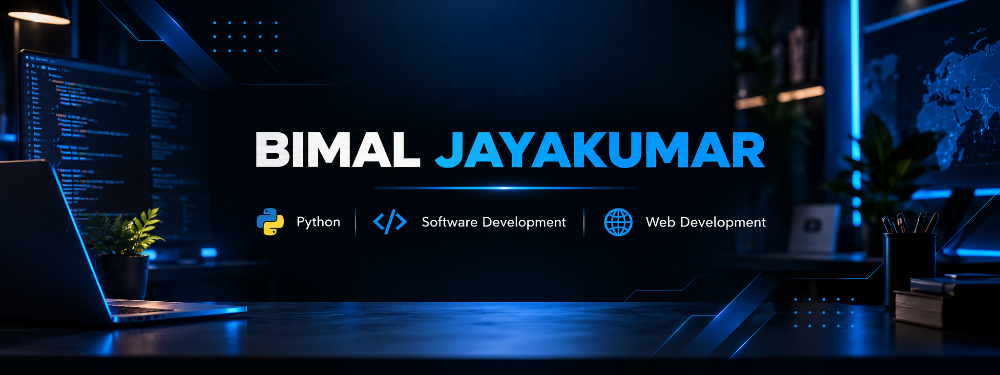
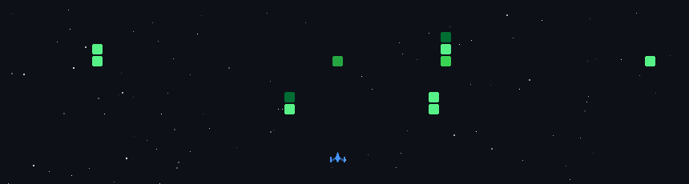

  

## ABOUT ME

I'm a <strong>Python Developer</strong> passionate about building modern web applications, exploring <strong>Artificial Intelligence</strong>, and transforming ideas into practical software solutions.

<em>Driven by curiosity. Focused on innovation. Always building.</em>

  

## MY JOURNEY

<em>My academic journey, from school to graduation.</em>

<strong>&nbsp; 2023 – 2026 | BACHELOR OF COMPUTER APPLICATIONS</strong>

&nbsp;&nbsp;&nbsp;&nbsp; **M. C. Varghese College of Arts &amp; Science**

&nbsp;&nbsp;&nbsp;&nbsp; Completed my BCA with a CGPA of **7.43 / 10**, studying computer applications, programming, databases, and software development.

 

<strong>&nbsp; 2021 – 2023 | HIGHER SECONDARY EDUCATION</strong>

&nbsp;&nbsp;&nbsp;&nbsp; **Holy Cross HSS, Thellakom**

&nbsp;&nbsp;&nbsp;&nbsp; Completed Higher Secondary Education under the **DHSE Kerala** curriculum.

 

<strong>&nbsp; 2020 – 2021 | SECONDARY EDUCATION</strong>

&nbsp;&nbsp;&nbsp;&nbsp; **M.E.M. Residential High School, Ettumanoor**

&nbsp;&nbsp;&nbsp;&nbsp; Completed Class X under the **CBSE** curriculum.

  

## TECH STACK

*Learn continuously. Build intelligently. Create with purpose.*

 

 

 

 

 

  

## GITHUB STATISTICS

Activity · Contributions · Languages · Consistency

  

  

 

Consistent progress. Continuous learning. Building through code.

  

## LET'S CONNECT

*Open to meaningful connections, collaboration, and new opportunities.*

 

  

BUILDING CONNECTIONS. SHARING IDEAS. CREATING IMPACT.

  

## SUPPORT MY WORK

*If you find my projects useful, consider supporting my work.*

  

## SPACE SHOOTER

My coding journey, turned into an arcade battle.

 

